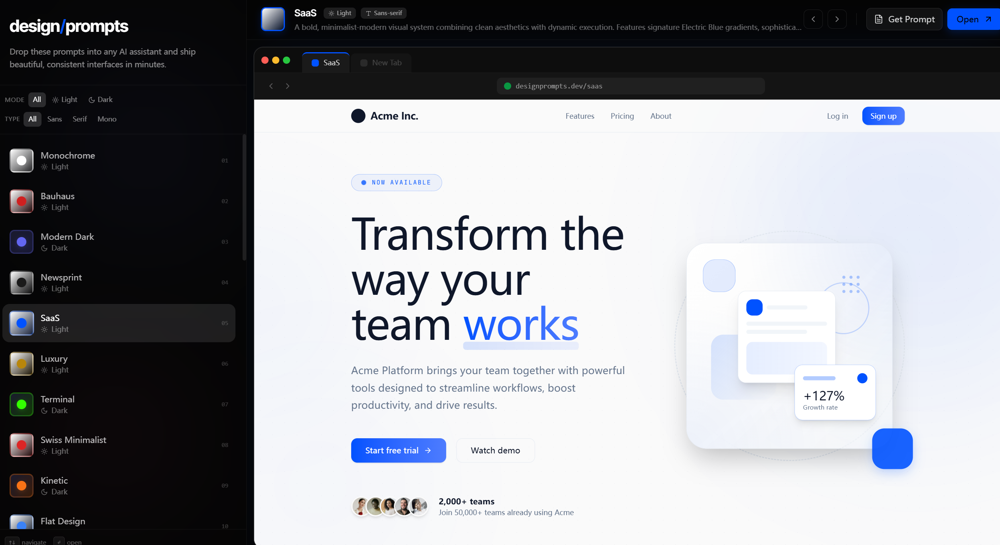
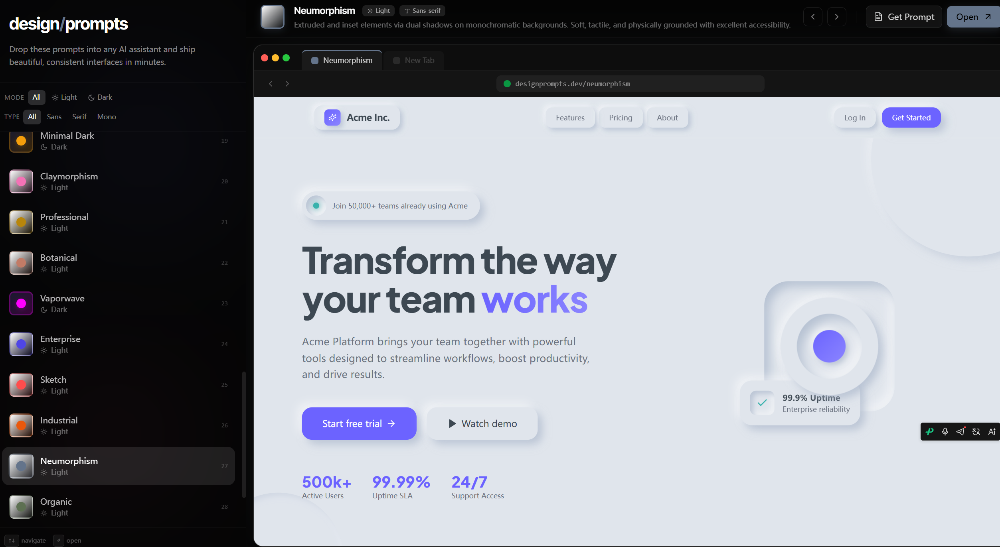
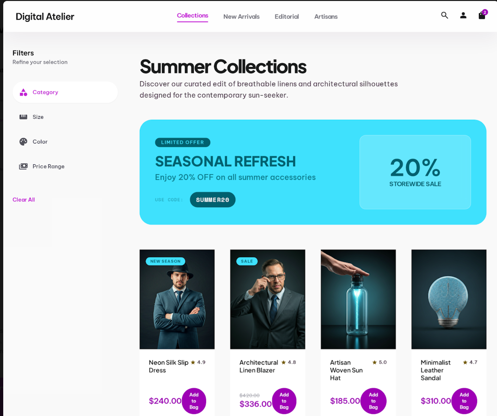

# 风格参考网站

[场景二](../README.md)的**做法 A** 用到这里：拿一个参考站当设计依据，提取成 `design.md`，
再变成可点击的原型。

```
参考站 ──→ web-design-extractor ──→ design.md ──→ design-spec-prototyper ──→ prototype.html
            区分「看到的」和「推断的」   设计规格        以规格为唯一视觉事实源
```

---

## 站点

这三个站给的是**风格方向和提示词**，不是现成的设计稿。选一个风格，把提示词喂给你的 AI 工具出稿，
或者直接拿站点本身的视觉当依据——两条路最后都汇进上面那条流程。

| 站点 | 链接 |
|---|---|
| Design Prompts | <https://www.designprompts.dev/> |
| DesignMD | <https://www.designmd.co/> |
| designmd.ai | <https://designmd.ai/> |

---

## 截图

### Design Prompts — SaaS 风格

左侧是风格清单（Monochrome、Bauhaus、Modern Dark、SaaS…），右侧是实时预览，
右上角 **Get Prompt** 拿到可直接丢给 AI 的提示词。



*截图来自 <https://www.designprompts.dev/>*

### Design Prompts — Neumorphism 风格

同一站点的另一套风格，演示怎么快速切换风格方向。



*截图来自 <https://www.designprompts.dev/>*

### 一个电商站风格的示例产出

筛选项、促销横幅、商品卡片的完整布局——这类页面适合先提取成 `design.md`，
再对照自己的产品做局部复用。



---

## 用的时候注意

**参考站只能当方向，不能当事实源。** 提取出来的 `design.md` 会区分
`[OBSERVED]`（看到的）、`[INFERRED]`（推断的）和 `[UNKNOWN]`（无法确立的）——
截图里没展示的交互状态一律是未知，不要当成设计意图。

**已有产品基线时，外部参考不能覆盖它。** 你有自己的品牌、导航和术语时，参考站只能提供灵感，
冲突时以你的体验基线为准（见 [`product-experience-foundation`](../skills/product-experience-foundation/)）。
