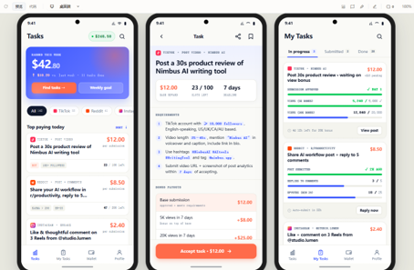
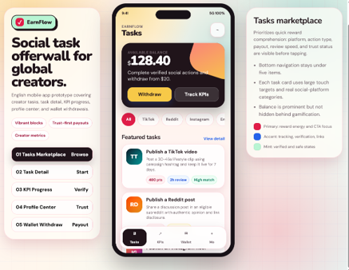
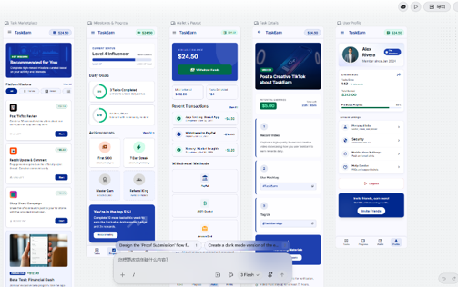
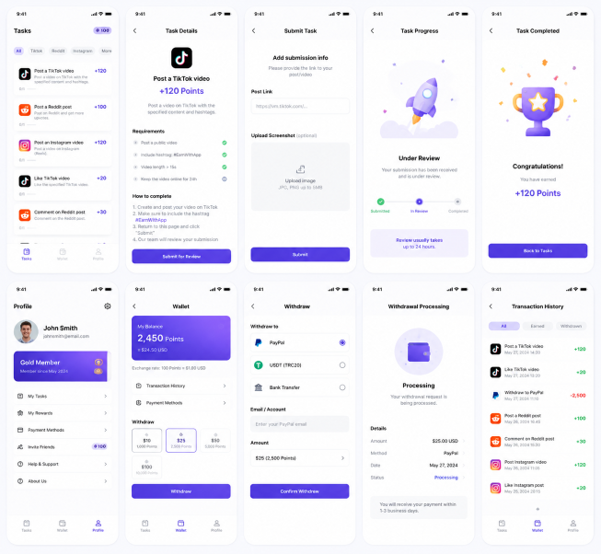
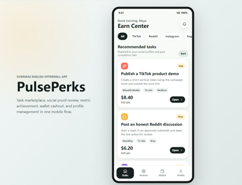

# 出稿工具与风格参考

[场景二](../README.md)「要在交给开发之前先把页面做出来」会用到这里列的东西。

- **有参考网站** → 直接看下面的[风格参考网站](#风格参考网站)，用做法 A
- **只有想法** → 从[出稿工具](#出稿工具)里挑一个先出稿，再用做法 B

两套做法拿到设计之后走的是同一条流程，区别只在「设计从哪来」。

---

## 出稿工具

共 7 个，按产出分两类：

- **产出可交互原型**——拿到的就是能点的 HTML，可以直接进流程
- **只产出 UI 图片**——截图之后从 `web-design-extractor` 接上，走法一样

### 产出可交互原型

| 工具 | 链接 | 说明 |
|---|---|---|
| **prototype-html** | <https://github.com/vagerent/prototype-html> | 开源。单文件 HTML，左侧界面 + 右侧说明、SVG 连线高亮。**本仓库已收录**，见 [`skills/prototype-html/`](../skills/prototype-html/) |
| **Open Design** | <https://open-design.ai/zh/> | 开源。产出可交互原型和 HTML 代码 |
| **ui-ux-pro-max** | <https://github.com/nextlevelbuilder/ui-ux-pro-max-skill> | 开源（MIT）。79 种 UI 风格、192 套配色推理规则、74 组字体搭配、22 个技术栈的落地指南 |
| **Figma AI Make** | <https://www.figma.com/> | 在线产品。产出可交互原型，可导出 React 源码，接上 AI 工作流继续做前后端 |
| **Axhub Make** | <https://axhub.im/make/> | 开源、本地运行。一条命令起服务：`npx -y @axhub/make@latest`，之后浏览器会自动打开 |

### 只产出 UI 图片

| 工具 | 链接 | 说明 |
|---|---|---|
| **Google Stitch** | <https://stitch.withgoogle.com/> | 谷歌出品，产出界面设计图 |
| **OpenAI Image 2** | <https://developers.openai.com/api/docs/models/gpt-image-2> | OpenAI 生图模型，产出界面设计图。API 里叫 `gpt-image-2`，产品里叫 ChatGPT Images 2.0，在 ChatGPT 里直接用 |

这两个直接打开链接就能用。前面五个里，`ui-ux-pro-max` 和 `Axhub Make` 需要装一下：

```bash
# ui-ux-pro-max —— 它是 Claude Code 插件
/plugin marketplace add nextlevelbuilder/ui-ux-pro-max-skill
/plugin install ui-ux-pro-max
```

```bash
# Axhub Make —— 本地起服务，浏览器自动打开
npx -y @axhub/make@latest
```

> **拿到东西之后分两种走法：**
>
> - **产出 HTML 的那五个**——稿子出来就是能点的原型，**直接用**，不必重走管线。
>   拿规格重新生成一遍，只会比原稿更差。
> - **只产出图片的那两个**——从 `web-design-extractor` 进，产出有证据支撑的 `design.md`，
>   再接 `design-spec-prototyper` 变成可点击的 `prototype.html`。
>
> 不管走哪条，都建议把设计特征固化成 `design.md`——它是**持续沉淀**，让下一个迭代和下一个
> AI 会话还记得你的设计规范，而不是每次重新猜。

### 一个示例提示词

这些工具吃的都是自然语言需求描述。示意：

```
用 prototype-html 帮我生成一个「会员积分商城」的后台管理原型，
菜单包含：总览、会员列表、积分明细、兑换记录。
总览要能看到今日新增会员数、积分发放趋势和待处理兑换。
```

描述得越具体（菜单结构、每个页面要看什么、有哪些状态），出稿越接近可直接评审的程度。

---

## 截图

下面几张是我们实际用这些工具出稿时的界面。

### Open Design



### ui-ux-pro-max



### Google Stitch



### OpenAI Image 2



### Axhub Make



---

## 风格参考网站

已独立成篇 → **[风格参考网站](design-references.md)**（站点列表、截图和使用注意）。

做法 A 用得上，做法 B 不需要。
