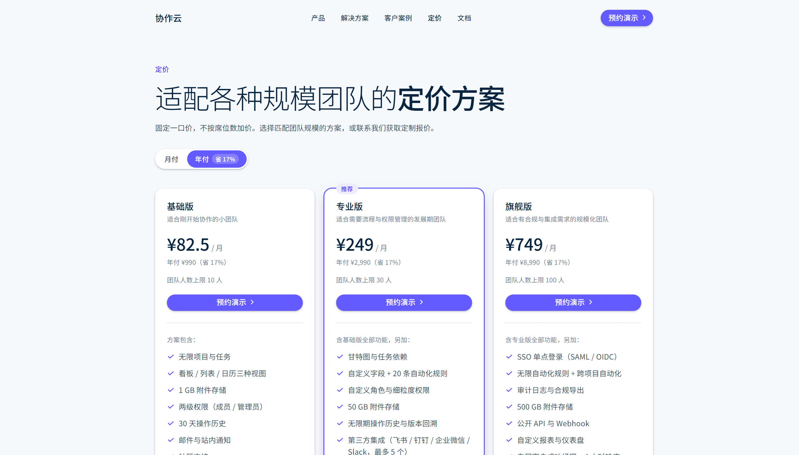
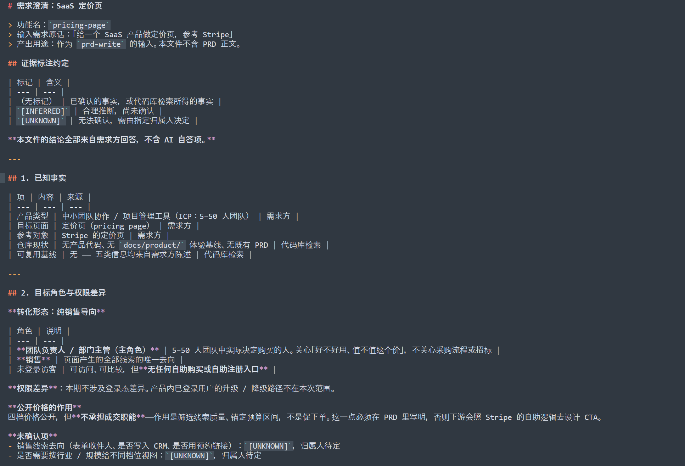
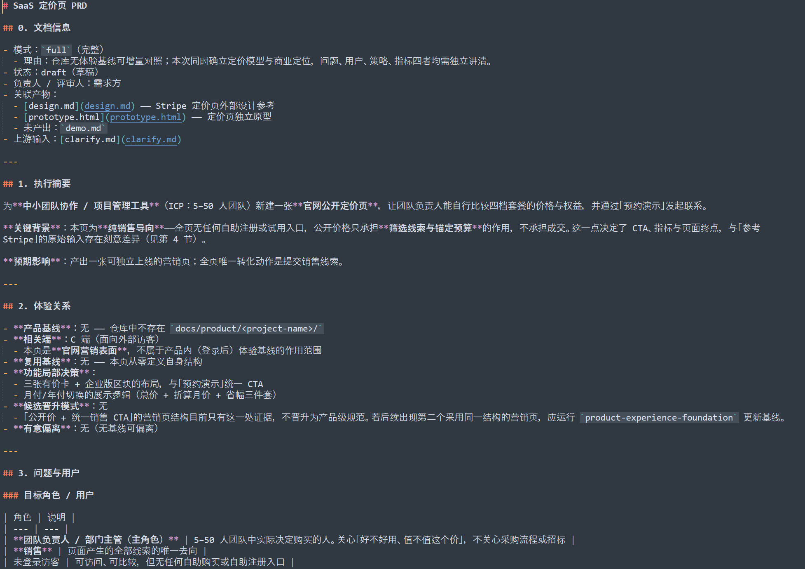
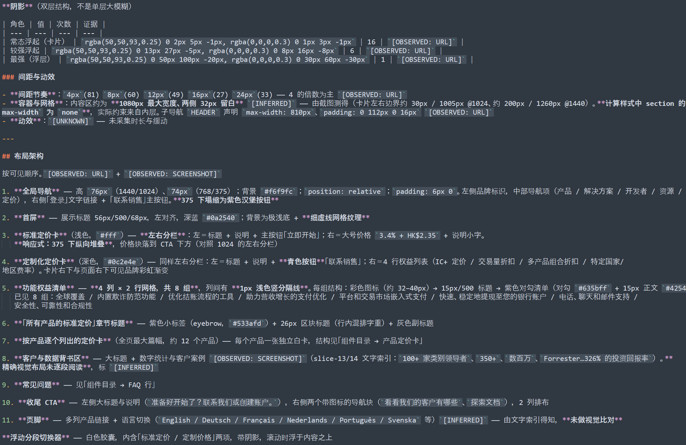

# 一次完整的真实运行



- 运行日期：2026-10-13
- 演示题材：给一个 SaaS 产品做**定价页**，参考 Stripe
- 产物：[`examples/pricing-page/`](../examples/pricing-page/)
- 想直接看结果：用浏览器打开 [`examples/pricing-page/prototype.html`](../examples/pricing-page/prototype.html)
- 四个产物各有一张实拍图，都在同一个目录下；下面每一步都配了

> 产物里的价格与权益是**占位数据**，不代表任何真实产品。

---

## 一、跑了哪五个步骤

| # | 命令 | 产物 |
| --- | --- | --- |
| 1 | `/requirement-clarify 给一个 SaaS 产品做定价页，参考 Stripe` | `clarify.md` |
| 2 | `/prd-write` | `prd.md` |
| 3 | `/grill-with-prd` | 写回 `prd.md` |
| 4 | `/web-design-extractor https://stripe.com/pricing` | `design.md` |
| 5 | `/design-spec-prototyper` | `prototype.html` |

**功能名只在第 1 步出现一次，而且是它自己从描述里取的**——`pricing-page` 这个名字，
后面四步没有一步需要你手动传：看到 `docs/prd/pricing-page/` 这个目录，就知道该读哪。

五步、四个产物，全部落在同一个目录 `docs/prd/pricing-page/`。

---

## 二、每一步的输入与产物

### 1. `/requirement-clarify`

**输入**（就一行）：

```text
/requirement-clarify 给一个 SaaS 产品做定价页，参考 Stripe
```

一句话进去，目标角色、范围边界、明确不做、已知约束全都空着。它**不问完不动笔**——一次只问一个问题，每题都先给一个它猜的默认答案，你确认或纠正就行：

| # | 它问的 | 你的回答 |
| --- | --- | --- |
| 1 | 这张页给谁看、要促成什么动作？ | 销售导向。低档和高档都走销售，全页不要自助注册入口 |
| 2 | 是官网公开页，还是产品内页面？从哪进？ | 官网公开页，顶栏「定价」和首页 CTA 进。产品内的升级不做 |
| 3 | 这一期做到哪一步？ | 到留资为止——只跳转和收线索，不碰支付、不碰开通 |
| 4 | 页面上要有哪些模块？ | 价格卡 + 月/年切换、每档核心权益、计费说明、FAQ 和企业版联系区块 |
| 5 | 价格怎么算、分几档？ | 固定一口价三档，不按席位、不按用量；另加一个企业版走联系销售 |
| 6 | 哪些看着相关但这一期不做？ | 支付与试用开通、自助注册、免费版、多币种多语言、优惠券与促销码 |
| 7 | 有什么已知约束？ | 月底上线；价格由需求方拍板 |
| 8 | 价格数字和每档权益定了吗？ | 还没定 → 记为 `[UNKNOWN]`，归属人写需求方 |

**怎么问出边界的**：第 1 题和第 6 题是分水岭——前者决定整页的 CTA 策略（要不要自助入口），后者决定 AI 会不会自作主张把支付、免费版、多币种一并做进来。这两条不问，写出来的 PRD 就不是这个产品了。

**产物**：`clarify.md` —— 目标角色 / 触发场景 / 范围 / 明确不做 / 已知约束，五类信息各成节。

它把上面这轮问答整理成可落笔的边界，每条结论都带来源标注：

- **转化形态**定为「纯销售导向」——低档也走销售，全页无自助入口
- **计价模式**定为固定一口价 × 3 档，不按席位、不按用量
- **明确不做**排除了：支付与试用开通、自助注册、免费版、多币种多语言、优惠券促销码
- **页面终点**定为「留资」，不是「发起转化」
- 留下 8 条 `[UNKNOWN]`，每条带归属人。其中 #1（表单落点）直接阻塞表单提交

[`clarify.md`](../examples/pricing-page/clarify.md) 实拍——顶部是证据标注约定与「本文件不含自答项」声明，
下面按五类信息分节：



### 2. `/prd-write`

**输入**：`clarify.md`；查找 `docs/product/`（不存在 → 记「无产品基线」）

**产物**：`prd.md` —— `full` 完整模式，0–10 节，含 R1–R7 七条需求与可勾选的验收标准。

模式选 `full` 而不是 `incremental`，理由是：仓库无体验基线可增量对照，且本次同时确立定价模型与商业定位，问题、用户、策略、指标四者都需要独立讲清。

价格与权益表写在第 5 节，让 PRD 自成闭环。

[`prd.md`](../examples/pricing-page/prd.md) 实拍——第 0 节「文档信息」把模式选择的理由也写在里面
（为什么是 `full` 而不是 `incremental`），下游审查时不用猜：



### 3. `/grill-with-prd`

**输入**：`prd.md`　**产物**：写回 `prd.md`（不产生新文件）

逐条质疑后改掉 6 处：

| 质疑 | 改动 |
| --- | --- |
| R3 是全页唯一转化动作，但表单收什么字段、隐私怎么合规，全文没定义 | R3 补上字段清单与隐私同意要求，验收标准从 6 条扩到 12 条 |
| §6 主指标依赖线索回收链路，而该链路在 §9 里是 `[UNKNOWN]` | 主指标改为页面侧可测项与销售侧回填项分列，并注明注册 / 试用类指标不适用 |
| §3 主角色定为「企业采购决策者」，与 ICP（5–50 人团队）不符——该规模通常不设专职采购岗 | 主角色改为「团队负责人」，FAQ 去掉招标与采购流程类问题 |
| 全文没有一处定义价格是含税还是不含税，而 R4 让页面自己写「含税情况待确认」 | 定为一律含税价，R4 要求页面明示「以上价格为含税价」 |
| 只有功能验收，没有非功能验收 | 新增 R7：可被搜索引擎收录 + 移动端 LCP < 2.5s + 主流浏览器兼容 |
| R3 要求「说明销售将在何时联系」，但这个时限从来没人定义过 | 明确承诺「1 个工作日内联系」，并把它写进 §8 风险表 |

这一步的价值不在改错别字，而在**把写作时看不出来的洞挖出来**——比如「主指标依赖一条尚未确认的链路」这种矛盾，单向写作几乎不可能自查到。

### 4. `/web-design-extractor`

**输入**：`https://stripe.com/pricing`　**产物**：`design.md`

用 Chrome CDP 无头模式采集：计算样式（按出现频次统计）、四档视口实测、全页分段截图。**两条证据线叠加使用**——计算样式给「用成了什么样」，截图给「谁更抢眼」。

拿到的关键事实：

- 标题字重是 **500**，不是 700（全页 700 只出现 9 次）——这是只看源码拿不到的
- 主按钮是 `#635bff` 胶囊，圆角 `16.5px`，高 33px，且 padding **上下左右都不对称**（`3px 12px 6px 16px`），是为右侧箭头做光学平衡
- 导航背景是 `#f6f9fc`，不是纯白；正文色 `#425466`
- 卡片阴影是**双层**结构，不是单层大模糊

`design.md` 里同时写了「证据边界」和「对当前项目的适用性」——后者给出的结论是**这张页不能作为本项目的信息架构模板**：Stripe 的定价页是按产品逐个列费率的索引页，没有「三档并列价格卡」这种结构；而它的主 CTA 是自助式的「立即开始」，与本项目的纯销售导向相反。

**可迁移的只有视觉语言**（排版比例、色彩、圆角、阴影、间距、响应式行为），信息架构和 CTA 策略必须自己设计。

[`design.md`](../examples/pricing-page/design.md) 实拍——每一条结论后面都跟着证据标签
（`[OBSERVED: URL]` / `[OBSERVED: SCREENSHOT]` / `[INFERRED]` / `[UNKNOWN]`），
一眼能看出哪些能当约束用、哪些只是默认值：



### 5. `/design-spec-prototyper`

**输入**：`design.md` + `prd.md`　**产物**：`prototype.html`（单文件，42.5 KB）

构图来自 **PRD**（不是参考站截图——那是另一个页面），视觉令牌来自 `design.md`。

| PRD | 在原型里 |
| --- | --- |
| R1 浏览并比较四个档位 | 三张有价卡 + 一个深色企业版区块；推荐档加标记与描边 |
| R2 切换月付 / 年付 | 原生 radio 做分段控件，默认年付；切换时价格、折算月价、省幅同步更新 |
| R3 发起联系 | 四字段表单 + 必勾隐私同意（不默认勾选）+ 邮箱与必填校验 |
| R4 计费与付款方式说明 | 四项说明 + 含税标注 |
| R5 查看 FAQ | 原生 `<details>`，直角平铺，键盘可操作 |
| R6 企业版区块 | 深色区块与三张有价卡视觉区分，CTA 指向同一表单 |
| R7 收录与性能 | title / description / canonical 位置预留；窄屏触控目标放大到 44px |

字体来源：`system`。参考站的 `sohne-var` 是需授权的商业字体，不可引用；本页是中文内容，中文由 `Noto Sans SC` 承载，拉丁字形与参考站不同——这一点写在 `design.md` 的重建规则里，也写在原型的交付说明里。

实拍——四档并排、月付 / 年付分段控件、每张卡下的「预约演示」CTA。
配色、圆角、按钮形态来自 `design.md` 的视觉令牌，**分区顺序来自 PRD，不是参考站**：


---

## 三、产物

```text
examples/pricing-page/
├── clarify.md        6.7 KB      ┐
├── clarify.png       320 KB      ┘ 上面第 1 节的实拍
├── prd.md           15.7 KB      ┐
├── prd.png           338 KB      ┘ 第 2 节的实拍
├── design.md        20.0 KB      ┐
├── design.png        559 KB      ┘ 第 4 节的实拍
├── prototype.html   42.5 KB      ┐
└── prototype.png     267 KB      ┘ 第 5 节的实拍
```

四张图都是产物的**实拍**，没有做任何裁剪或修饰——看到的就是当时交付的那份东西。

---

## 四、验证

| 检查 | 结果 |
| --- | --- |
| 编码 | 四个文件 U+FFFD 均为 0 |
| 静态 | 19 个 id 无重复；`label[for]` 无悬空；`aria-describedby` 6 处全部命中；38 个装饰性 SVG 均标 `aria-hidden` |
| 反向断言 | 全页无「注册 / 试用 / 立即购买 / 免费」；FAQ 无「招标 / 采购流程」 |
| 渲染 | Chrome headless，375 / 768 / 1024 / 1440 四档 |
| 几何 | 四档 `scrollWidth == clientWidth`，无横向溢出 |
| 字体 | `document.fonts.check` 确认 Noto Sans SC 400 / 500 均已加载 |
| 交互 | 月 / 年切换、FAQ 展开、表单校验与隐私同意拦截 |

**没验到的**：

- 真人键盘 / 读屏实测——只验了 DOM 属性，没按 Tab 走一遍
- 只测了 Chrome，没测 Safari / Firefox
- 悬停、焦点、FAQ 展开态没有逐态截图比对
- `prefers-reduced-motion` 未做实机验证
- 表单没有真实提交过——落点在 `prd.md` 待决 #1 里仍是 `[UNKNOWN]`，原型用空值常量走演示分支
